

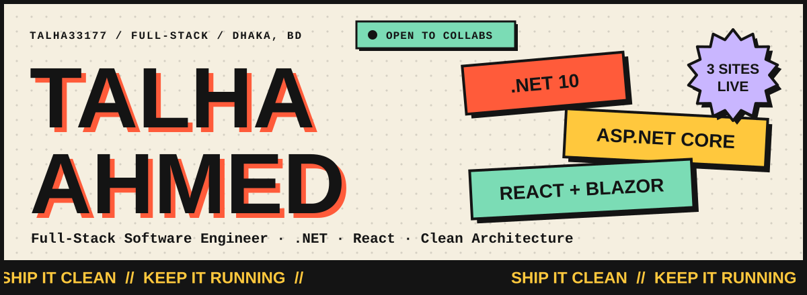

 

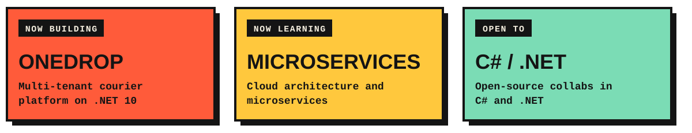

 

<a href="http://grabity.bdcorex.com">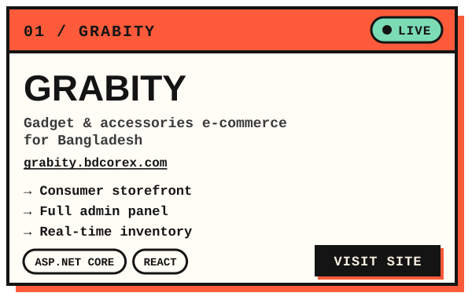</a>
<a href="https://bdcorex.com">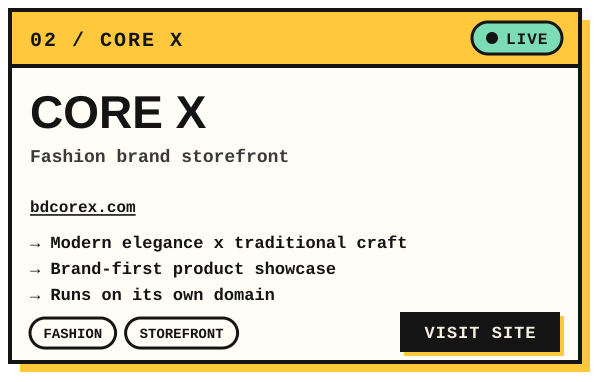</a>
<a href="https://talha.bdcorex.com">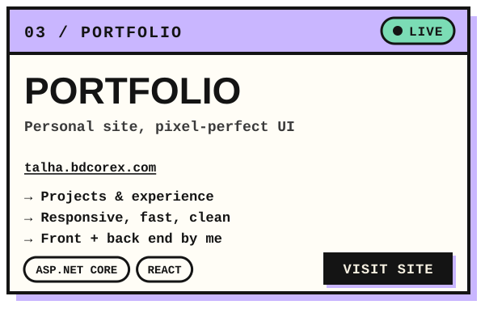</a>
<a href="https://github.com/talha33177/OneDrop-Courier-Service-Project-">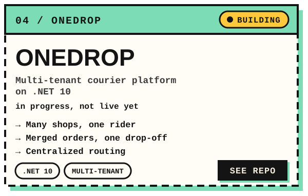</a>

 

Source: [OneDrop](https://github.com/talha33177/OneDrop-Courier-Service-Project-) · [Grabity](https://github.com/talha33177/Grabity) · [DUMPMIS](https://github.com/talha33177/DUMPMIS)

 

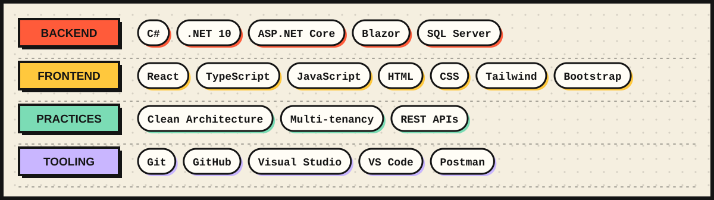

 

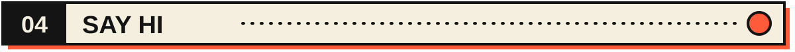

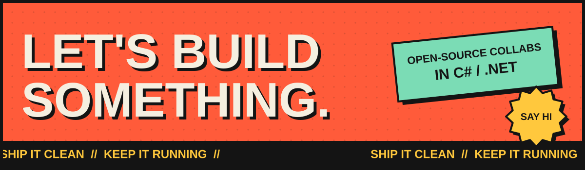

<a href="mailto:talha33177.net@gmail.com">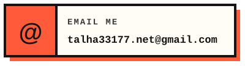</a>
<a href="https://talha.bdcorex.com">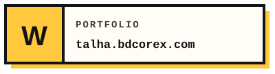</a>
<!-- TODO: replace YOUR-USERNAME with your LinkedIn handle -->
<a href="https://linkedin.com/in/YOUR-USERNAME">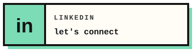</a>

 

Plain-text version

 

**Talha Ahmed**, Full-Stack Software Engineer in Dhaka, Bangladesh. *Ship it clean. Keep it running.*

- **Now building:** OneDrop, a multi-tenant courier platform on .NET 10
- **Now learning:** cloud architecture and microservices
- **Open to:** open-source collabs in C# / .NET
- **Live:** [Grabity](http://grabity.bdcorex.com) (gadget e-commerce), [CORE X](https://bdcorex.com) (fashion storefront), [Portfolio](https://talha.bdcorex.com)
- **Stack:** C#, .NET 10, ASP.NET Core, Blazor, SQL Server, React, TypeScript, JavaScript, HTML, CSS, Tailwind, Bootstrap, Git, GitHub, Visual Studio, VS Code, Postman
- **Practices:** Clean Architecture, multi-tenancy, REST APIs
- **Email:** [talha33177.net@gmail.com](mailto:talha33177.net@gmail.com)

Every graphic here is generated by [`tools/build.py`](tools/build.py). Edit the script and run `python3 tools/build.py` to restyle everything.
