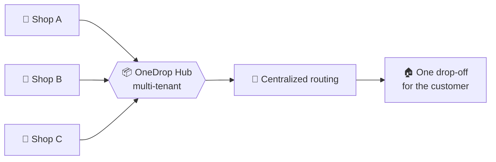
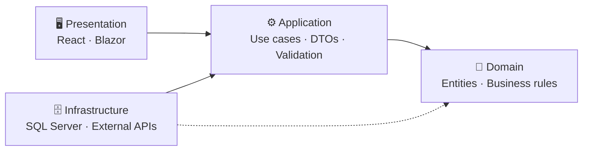

<!-- ═══════════════════════════ HERO ═══════════════════════════ -->
<div align="center">


<br/>

<a href="https://talha.bdcorex.com"></a>
<a href="mailto:talha33177.net@gmail.com"></a>
<!-- TODO: replace YOUR-USERNAME with your LinkedIn handle -->
<a href="https://linkedin.com/in/YOUR-USERNAME"></a>


<br/><br/>


</div>

<br/>

<!-- ═══════════════════════════ DOMAIN / ABOUT ═══════════════════════════ -->
## 📂 `src/Domain/Developer.cs`

```csharp
namespace TalhaAhmed.Domain;

public sealed record Developer
{
    public string Name    => "Talha Ahmed";
    public string Role    => "Full-Stack Software Engineer";
    public string BasedIn => "Dhaka, Bangladesh 🇧🇩";

    public string[] Backend   => ["C#", ".NET 10", "ASP.NET Core", "Blazor", "SQL Server"];
    public string[] Frontend  => ["React", "TypeScript", "Tailwind", "Bootstrap"];
    public string[] Practices => ["Clean Architecture", "Multi-tenancy", "REST APIs"];

    public string NowBuilding => "OneDrop — multi-tenant courier platform";
    public string NowLearning => "Cloud architecture & microservices";
    public string OpenTo      => "Open-source collabs in C# / .NET";

    public string Motto => "Ship it clean. Keep it running.";
}
```

<!-- ═══════════════════════════ PRODUCTION ═══════════════════════════ -->
## 🚀 `deploy/production` — live right now

<table>
  <tr>
    <td width="33%" valign="top" align="center">
      <h3>🛒 Grabity</h3>
      <a href="http://grabity.bdcorex.com"></a>
      <p><i>Gadget & accessories e-commerce for Bangladesh</i></p>
      <p align="left">
        ▸ Consumer storefront<br/>
        ▸ Full admin panel<br/>
        ▸ Real-time inventory
      </p>
      
      
      <br/><br/>
      <a href="http://grabity.bdcorex.com"><b>Visit →</b></a> · <a href="https://github.com/talha33177/Grabity"><b>Code →</b></a>
    </td>
    <td width="33%" valign="top" align="center">
      <h3>👔 CORE X</h3>
      <a href="https://bdcorex.com"></a>
      <p><i>Fashion brand storefront</i></p>
      <p align="left">
        ▸ Modern elegance × traditional craft<br/>
        ▸ Brand-first product showcase<br/>
        ▸ Runs on its own domain
      </p>
      <!-- TODO: add CORE X stack badges -->
      <br/><br/>
      <a href="https://bdcorex.com"><b>Visit →</b></a>
    </td>
    <td width="33%" valign="top" align="center">
      <h3>🧑‍💻 Portfolio</h3>
      <a href="https://talha.bdcorex.com"></a>
      <p><i>Personal site, pixel-perfect UI</i></p>
      <p align="left">
        ▸ Projects & experience<br/>
        ▸ Responsive, fast, clean<br/>
        ▸ Front + back end by me
      </p>
      
      
      <br/><br/>
      <a href="https://talha.bdcorex.com"><b>Visit →</b></a>
    </td>
  </tr>
</table>

<!-- ═══════════════════════════ FLAGSHIP ═══════════════════════════ -->
## 📦 `src/Flagship` — OneDrop Courier

> Many shops, one rider, one doorstep. A multi-tenant delivery platform that merges orders from different stores into a single drop-off.



<div align="center">
  <a href="https://github.com/talha33177/OneDrop-Courier-Service-Project-"></a>
  <a href="https://github.com/talha33177/DUMPMIS"></a>
</div>

<!-- ═══════════════════════════ ARCHITECTURE ═══════════════════════════ -->
## 📐 `docs/architecture` — how every project is wired



<sub>Dependencies point inward → the domain never knows about the database or the UI.</sub>

<!-- ═══════════════════════════ STACK ═══════════════════════════ -->
## 🧰 `src/Infrastructure` — the stack

<div align="center">

**Core**<br/>


**Frameworks**<br/>

<br/>


**Tooling**<br/>


</div>

<!-- ═══════════════════════════ METRICS ═══════════════════════════ -->
## 📊 `tests/metrics` — all green

<div align="center">


</div>

<!-- ═══════════════════════════ SNAKE ═══════════════════════════ -->
<div align="center">
  <picture>
    <source media="(prefers-color-scheme: dark)" srcset="https://raw.githubusercontent.com/talha33177/talha33177/output/github-snake-dark.svg">
    
  </picture>
</div>

<!-- ═══════════════════════════ FOOTER ═══════════════════════════ -->
```console
$ dotnet build TalhaAhmed.sln -c Release
  TalhaAhmed.Domain          -> curiosity.dll
  TalhaAhmed.Application     -> problem-solving.dll
  TalhaAhmed.Infrastructure  -> dotnet + sql-server.dll
  TalhaAhmed.Presentation    -> react + blazor.dll

Build succeeded.  0 Warning(s)  0 Error(s)  —  open to collabs, say hi 👋
```


